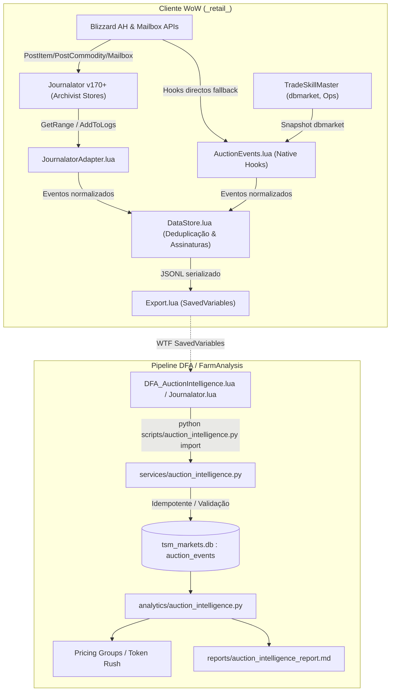

# DFA Auction Intelligence — Arquitectura de Fluxo de Dados e Proveniência

Este documento define a cadeia de custódia, proveniência e integridade dos dados observados no sistema de leilão WoW pelo projecto DFA.

## 1. Proveniência por Tipo de Evento

| Evento | Fonte Primária | Gatilho | Proveniência / Campos Verificados | Confiança |
|---|---|---|---|---|
| **Venda Concluída (`sale`)** | Mailbox (`GetInboxInvoiceInfo`) | Recolha do correio com ouro | Ouro bruto, comissão da AH (5% consignment), reembolso de depósito, nome do comprador, timestamp UNIX | **Verificado** |
| **Compra Concluída (`purchase`)** | Mailbox (`GetInboxInvoiceInfo`) | Recolha do item comprado | Ouro pago, quantidade, nome do vendedor, timestamp UNIX | **Verificado** |
| **Publicação (`listing`)** | `C_AuctionHouse.PostItem` / `PostCommodity` | Momento em que o anúncio é submetido | Preço pedido (buyout/bid), quantidade, duração, depósito cobrado, timestamp UNIX | **Verificado** |
| **Cancelamento (`cancel`)** | Mailbox (`GetInboxHeaderInfo`) | Anúncio cancelado pelo jogador | Item devolvido, quantidade, depósito perdido, timestamp UNIX | **Verificado** |
| **Expiração (`expire`)** | Mailbox (`GetInboxHeaderInfo`) | Anúncio expirado após duração | Item devolvido, quantidade, duração decorrida, depósito perdido, timestamp UNIX | **Verificado** |
| **Referência de Mercado (`market_ref`)** | `TSM_API.GetCustomPriceValue` | No momento da publicação | `dbmarket` local no instante em que o item é listado | **Proxy Medido** |

## 2. Princípios de Separação de Conceitos

1. **Preço Pedido (Asking Price)**: Valor fixado na publicação pelo jogador ou concorrente. Não é receita nem liquidez.
2. **Referência de Mercado (`dbmarket`)**: Média local ponderada de anúncios. Não reflecte necessariamente transacções.
3. **Facturação Bruta (Gross Proceeds)**: Total em cobre transferido pelo comprador na factura da casa de leilões.
4. **Facturação Líquida (Net Proceeds)**: `Facturação Bruta - Comissão Consignment (5%) + Reembolso de Depósito`.
5. **Custo de Depósito Perdido**: Depósitos retidos pela Blizzard em leilões que expiraram sem venda.
6. **Sell-Through Rate Real**: Denominador restrito a desfechos definitivos: `Vendas / (Vendas + Expirações)`. Cancelamentos não são falhas de procura.
